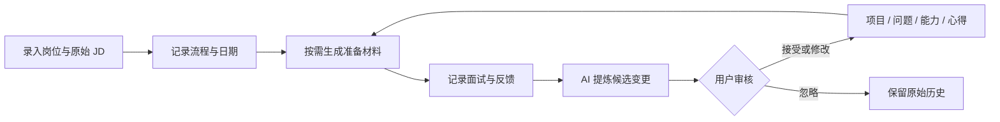

# 整体求职规划管理助手：产品设计与阶段路线

- 文档日期：2026-07-27
- 文档状态：待用户最终确认
- 产品性质：小范围共享、非商业化、单用户数据空间
- 核心价值：把每次投递和面试转化为下一次可复用的经验资产

## 1. 产品定义

这是一个覆盖完整求职周期的本地优先工具。它不负责修改简历，也不负责自动投递，而是帮助用户完成以下闭环：

1. 记录感兴趣或已经投递的岗位。
2. 保存原始 JD、流程阶段、日期、准备材料和反馈。
3. 在面试后整理文字记录或转写结果。
4. 由 AI 提炼问题、能力证据、项目表达缺口和心得。
5. 用户审核 AI 提出的变更。
6. 将确认后的内容沉淀到问题库、项目档案、能力主题和随想。
7. 在下一次准备材料时复用这些个人资产。

产品服务所有知识型岗位，不围绕某一个具体职业建立专用逻辑。岗位类别只是普通属性；共性能力从用户实际保存的 JD 和面试记录中归纳。

## 2. 目标与非目标

### 2.1 核心目标

用户连续使用一个月后，应能看到经验复利：

- 每次面试产生的有效内容不再散落。
- 新岗位的准备材料能够复用过去确认过的问题、项目和经验。
- 用户能够从多个 JD 中看到反复出现的能力要求。
- 用户能够回看某次面试如何改变了自己的项目表达和问题准备。

### 2.2 辅助目标

- 清楚知道自己记录了哪些岗位。
- 清楚知道每个岗位当前处于哪个阶段。
- 清楚看到流程节点的实际日期和预计日期。
- 统计累计岗位数、面试数、流程分布和反馈结果。

### 2.3 明确不做

- 简历撰写或修改。
- 自动投递。
- 招聘网站爬取。
- 待办任务和提醒通知。
- 日历同步。
- 商业化账号、付费和团队管理。
- 用户之间共享同一份求职数据。
- 云端业务数据库。
- 手机后台长期静默同步。

## 3. 核心设计原则

### 3.1 双层闭环

系统分为执行层和资产层。

- 执行层保存当时发生的事情：岗位、流程、准备材料、面试和反馈。
- 资产层保存以后还能复用的内容：项目档案、问题库、能力主题、随想与心得。
- AI 变更层连接两者：AI 只能提出建议，不能直接修改长期资产。

### 3.2 历史与资产分离

- 原始 JD 只保存完整文本，不保存结构化 JD。
- 不记录岗位来自哪个招聘渠道。
- 当次准备材料保存生成结果和当时使用的数据快照；资产之后更新时，不覆盖历史准备材料。
- 面试记录和反馈是历史事实，不能被资产更新反向改写。
- AI 结论保留与具体岗位或面试的内部关联，以便用户理解该建议为何产生。

### 3.3 明确触发 AI

以下操作都必须由用户主动触发：

- 识别截图。
- 转写录音。
- 生成岗位准备材料。
- 总结面试。
- 从多个 JD 归纳能力主题。
- 生成待确认变更。

系统不得在后台擅自调用外部 AI 或消耗 API。

## 4. 完整用户闭环

### 4.1 录入岗位

用户可以：

- 手动输入公司、岗位名、兴趣度和原始 JD。
- 粘贴原始 JD 文本。
- 在移动阶段通过截图识别得到文本，并在确认后保存。

系统不保存“招聘网站”“内推”等投递来源，也不持久化 AI 解析出的结构化 JD。

### 4.2 跟进流程

系统提供默认流程：

`感兴趣 → 已投递 → 笔试 → 面试 → Offer / 拒绝 / 主动结束`

用户可以：

- 增加、改名、删除或跳过阶段。
- 为节点记录实际日期。
- 为尚未发生的节点记录预计日期。
- 保存对方反馈和个人备注。

自定义节点必须映射到统一大阶段，以支持跨岗位统计。系统只展示流程与日期，不产生待办和提醒。

### 4.3 按需准备

用户点击“生成准备材料”后，系统向外部 AI 提供：

- 当前岗位的原始 JD。
- 用户选择的项目档案。
- 已确认的问题与回答。
- 已确认的能力主题和心得。
- 当前使用的 Prompt 模板。

生成结果保存为独立快照。用户可以再次生成新版本，但旧版本保持不变。

#### 4.3.1 用户确认的岗位准备分析框架（2026-07-27）

岗位准备的默认 Prompt 在基础六部分之外，必须生成以下四组结构化结果：

1. **Map Competencies**
   - 从 JD 中提炼标准能力 Top 5。
   - 综合关键词出现频率、所在位置与强调程度排序。
   - 排名必须为唯一且有序的 1—5，并给出每项能力的 JD 证据或排序理由。
2. **Company Map**
   - 从 STARS 五阶段中严格选择一个：`Startup`、`Turnaround`、`Realignment`、`Sustaining Success`、`Crisis`。
   - 同时说明阶段判断、当前优先事项和文化信号。
3. **Dream Candidate Avatar**
   - `Typical Day` 是按时间组织的任务时间线。
   - `Superpower` 用简单语言说明候选人如何解决 JD 最大痛点。
   - `Success Story` 是候选人使用该 `Superpower` 的成功故事。
   - `Quote` 体现候选人的信念体系。
   - `Pain Profile` 解释岗位为何存在，以及候选人如何解决这一根本问题。
4. **Action Guide**
   - 包含一句自我介绍 tagline、一句文化匹配表达和恰好 3 个针对当前岗位定制的收尾问题。

分析正文使用中文，但保留上述 English terms。默认 Prompt 的更新只用于新安装或默认初始化；用户已经自定义的岗位准备 Prompt 不会被覆盖。

兼容策略为“新生成严格、旧历史宽容”：新的 AI 生成结果必须同时包含原基础六字段和四组新结构；旧版仅含基础六字段的历史快照继续可读，并在界面标注为“旧版结构”。单条损坏快照只影响自身展示，不影响岗位详情与其他历史版本。

发送前确认由主进程提供只读外发预览，不调用 AI、不写入历史。预览包含完整公司与岗位、原始 JD、当前岗位准备 Prompt、每个所选项目与问题档案，以及与实际 user message 使用相同序列化结果的岗位数据 JSON；长内容默认折叠、可逐项展开，并按纯文本安全呈现。Renderer 只提交岗位和资产 ID，不能提交或覆盖 Prompt。最终生成时主进程仍重新读取最新数据；界面必须明确说明预览后发生的变更可能导致最终外发不同，并引导用户重新预览。

### 4.4 面试记录与复盘

第一阶段支持手动输入面试记录；第二阶段增加手机录音转写。

一份面试记录包括：

- 所属岗位和轮次。
- 面试日期。
- 用户输入或确认后的文字记录。
- 用户补充的个人感受。
- AI 摘要。
- 后续收到的结果或反馈。

### 4.5 待确认变更

AI 可以提出以下候选变更：

- 新增或合并面试官问题。
- 新增或修改候选人反问。
- 新增问题回答草稿。
- 修改项目档案中的背景、决策、证据、反思或讲述版本。
- 新增能力主题或能力证据。
- 新增心得或建议关联已有心得。

用户可以逐条：

- 接受。
- 修改后接受。
- 忽略。

只有接受后的内容才能写入资产层。

### 4.6 资产回流

确认后的资产在下一次生成准备材料时可被用户选择并复用，从而完成闭环。

## 5. 页面与信息架构

### 5.1 桌面端

桌面端偏向集中整理和分析，采用以下主导航：

1. **总览**
   - 累计岗位数。
   - 各阶段岗位数量。
   - 进入面试的岗位数量。
   - 已完成复盘数量。
   - 待确认变更数量。
   - 流程日期时间线。
   - 共性能力及出现频率。

2. **岗位**
   - 岗位列表、筛选和搜索。
   - 岗位详情。
   - 岗位详情标签页：概况、原始 JD、流程、准备材料、面试记录。

3. **复盘中心**
   - 面试记录。
   - AI 摘要。
   - 待确认变更。
   - 变更审核历史。

4. **项目档案**
   - 背景、目标、角色、关键决策、成果、证据、反思。
   - 不同面试场景的讲述版本。

5. **问题库**
   - 面试官问题。
   - 候选人反问。
   - 回答草稿。
   - 关联能力、项目和出现次数。

6. **随想与心得**
   - 自由文本记录。
   - 可选关联岗位、项目、问题或能力。

7. **设置与同步**
   - 外部 AI 配置。
   - Prompt 模板。
   - 数据备份与恢复。
   - 第二、三阶段的设备配对和同步状态。

### 5.2 手机端

手机端偏向采集、查看和快速确认，底部导航为：

- 总览。
- 岗位。
- 统一采集入口。
- 复盘。
- 资产。

统一采集入口在第二阶段支持：

- 拍摄或选择 JD 截图。
- 录制面试。
- 输入普通文字。
- 记录随想。

项目、问题库和随想在手机端归入“资产”入口，但数据能力与桌面端一致。

## 6. 核心数据模型

### 6.1 执行层

#### 岗位

- 唯一标识。
- 公司。
- 岗位名。
- 兴趣度。
- 原始 JD 文本。
- 当前阶段。
- 最终结果。
- 创建和更新时间。

#### 流程节点

- 所属岗位。
- 自定义节点名称。
- 统一大阶段。
- 实际日期。
- 预计日期。
- 对方反馈。
- 备注。
- 顺序。

#### 准备材料

- 所属岗位。
- Prompt 模板快照。
- 使用的资产版本快照。
- AI 生成结果。
- 基础六字段：岗位摘要、能力重点、项目讲述要点、可能问题、候选人反问、风险提示。
- 新版四组结构：`competencyMap`、`companyMap`、`dreamCandidateAvatar`、`actionGuide`。
- `competencyMap` 固定 5 项且 rank 依次为 1—5；`companyMap.stage` 使用严格 STARS 枚举；`actionGuide.questions` 固定 3 项。
- 生成时间。

#### 面试记录

- 所属岗位。
- 轮次。
- 日期。
- 已确认的文字记录。
- 用户补充。
- AI 摘要。
- 反馈结果。

### 6.2 AI 变更层

#### 待确认变更

- 变更类型。
- 目标资产类型和标识。
- AI 建议内容。
- 用户修改后的内容。
- 关联岗位或面试记录。
- 状态：待处理、已接受、已忽略。
- 确认时间。

### 6.3 资产层

#### 项目档案

- 项目名称。
- 背景。
- 目标。
- 用户角色。
- 关键决策。
- 成果与证据。
- 反思。
- 讲述版本。
- 版本历史。

#### 问题条目

- 类型：面试官问题或候选人反问。
- 问题正文。
- 回答草稿。
- 关联项目。
- 关联能力。
- 出现次数。
- 状态和版本。

#### 能力主题

- 主题名称。
- 在 JD 中出现的频率。
- 已有证据。
- 薄弱点。
- 用户合并或改名记录。

#### 随想与心得

- 标题。
- 自由文本。
- 可选关联对象。
- 创建和更新时间。

## 7. AI 与附件规则

### 7.1 外部 AI

- 用户自行配置外部 AI 的 API 地址、模型和密钥。
- 密钥只保存在当前设备的系统安全存储中。
- 手机和电脑分别保存自己的 API 配置。
- 外部 AI 不是业务数据存储层。
- 每次调用前明确展示将要发送的数据类型。

### 7.2 结构化输出

需要写入系统的数据必须要求 AI 返回受约束的结构，并经过本地校验：

- 格式无效时不写入数据库。
- 内容缺失时提示用户重试或手动补充。
- 所有候选资产变更进入待确认区。

### 7.3 录音与截图生命周期

1. 原始文件先保存在发起操作的本地设备临时区。
2. 文件发送给外部 AI 进行识别或转写。
3. 结果返回后，用户校对并确认。
4. 系统保存确认后的文字结果。
5. 系统永久删除当前设备上的原始文件。
6. 删除动作记录为同步标记，避免另一设备恢复原始文件。

如果 AI 超时、返回错误或用户未确认，原始文件不得自动删除。

## 8. 本地优先与跨端架构

### 8.1 设备职责

桌面应用和手机 App 都具备：

- 独立本地数据库。
- 完整文字与结构化数据。
- 离线编辑能力。
- 外部 AI 调用能力。
- 离线变更队列。

桌面端更适合完整归档和分析；手机端更适合拍摄、录音、快速记录和审核。

### 8.2 局域网同步

第三阶段实现：

- 首次通过二维码配对并交换设备密钥。
- 只接受已配对设备。
- 两端处于同一局域网、桌面应用运行且手机 App 打开时自动同步。
- 提供“立即同步”按钮。
- 使用增量变更日志，不重复传输全部数据。
- 同步中断后可以从上次位置继续。
- 每个变更具有唯一标识，重复传输不会重复创建记录。
- 不同字段的修改可以自动合并。
- 同一字段同时修改时，由用户选择版本或手动合并。
- 删除动作必须跨端传播。

不承诺手机在后台长期静默同步。

## 9. 异常处理

### 9.1 AI 失败

- 保留用户输入和临时附件。
- 不产生半完成资产。
- 显示失败原因和可重试操作。
- 不重复扣除本地状态或生成重复记录。

### 9.2 同步失败

- 保留未同步变更。
- 显示最后成功同步时间。
- 可安全重试。
- 冲突不自动覆盖。

### 9.3 数据安全

- 应用异常退出后，已提交的数据库事务必须完整或完全回滚。
- 原始附件删除前必须确认文字结果已保存。
- 第一阶段提供本地备份导出与恢复，避免单机损坏导致全部数据丢失。

## 10. 分阶段路线

### 阶段 1：桌面端核心闭环

目标：验证“经历沉淀能够改善下一次准备”的核心价值。

范围：

- 本地数据库和桌面应用。
- 岗位列表、岗位详情和原始 JD。
- 默认流程、自定义流程、实际日期和预计日期。
- 按需生成准备材料。
- 手动输入面试记录。
- AI 面试总结。
- 待确认变更。
- 项目档案。
- 面试官问题库和候选人反问库。
- 能力主题。
- 随想与心得。
- 总览统计。
- 外部 AI 配置与 Prompt 模板。
- 本地备份与恢复。

不包含：

- 手机 App。
- 截图识别。
- 录音转写。
- 局域网同步。

### 阶段 2：手机独立使用与移动采集

目标：让用户在没有电脑时完成录入、查看、AI 处理和审核。

范围：

- 手机本地数据库。
- 完整文字数据与离线编辑。
- JD 截图识别。
- 面试录音转写。
- 识别结果确认和原始附件删除。
- 手机直接调用外部 AI。
- 移动端快速采集和审核。

阶段 2 结束时，手机和电脑仍是独立数据空间。

### 阶段 3：局域网加密同步

目标：让同一用户的手机与电脑数据合流。

范围：

- 二维码配对。
- 设备身份和加密连接。
- 增量同步。
- 中断恢复。
- 冲突检测和处理。
- 删除标记传播。
- 同步状态和诊断日志。

## 11. 第一版验收标准

第一版必须完成以下端到端场景：

1. 用户创建岗位并粘贴一份原始 JD。
2. 用户记录自定义流程节点和日期。
3. 用户主动生成一份准备材料。
4. 用户添加一次面试文字记录。
5. AI 生成摘要，并提出问题库、项目档案、能力主题或心得的候选变更。
6. 用户逐条接受、修改或忽略变更。
7. 用户创建第二个岗位并生成准备材料。
8. 第二次准备能够明确使用上一步确认的长期资产。
9. 用户可以在总览中看到岗位数量、阶段分布、面试记录和能力主题。
10. 应用重启后数据完整；备份导出后可以恢复。

如果步骤 5 至 8 无法走通，第一版不算完成。

## 12. 测试策略

### 12.1 核心逻辑测试

- 自定义阶段映射和统计。
- 准备材料快照。
- 待确认变更状态流转。
- 项目与问题版本更新。
- 重复变更合并建议。

### 12.2 AI 契约测试

- 有效结构化输出。
- 缺字段输出。
- 非法格式。
- 超时和服务错误。
- 重试不产生重复数据。
- AI 建议不能绕过待确认区。

### 12.3 数据测试

- 数据库事务回滚。
- 应用重启恢复。
- 备份与恢复一致性。
- 原始附件确认后删除。

### 12.4 同步测试

第三阶段必须覆盖：

- 双端离线新增。
- 同一记录不同字段修改。
- 同一字段冲突。
- 重复传输。
- 同步中断和恢复。
- 删除传播。
- 已确认删除的附件不能复活。

### 12.5 端到端测试

使用第 11 节的完整闭环作为第一版主验收流程。

## 13. 可行性结论

### 高可行性

- 岗位、流程、资产和统计。
- 原始 JD 与准备材料管理。
- 外部 AI 生成与总结。
- 待确认变更机制。
- 项目档案和问题库。
- 截图识别和录音转写。

### 中高可行性

- 手机完整离线使用。
- 桌面与手机共享数据模型。

### 主要工程风险

- 局域网设备发现。
- Windows 防火墙与移动系统网络权限。
- 增量同步和冲突处理。
- 移动系统后台运行限制。
- 外部 AI 对长录音的时长、大小、费用和稳定性限制。

因此，局域网同步必须放在数据模型稳定之后实现。分三阶段推进是可行且风险最低的路线。

