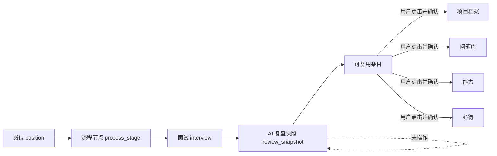

# 模块内复盘与主动纳入数据流设计

## 目标

把 AI 结果留在产生它的业务上下文中：面试复盘归属于对应面试与流程节点，项目整理归属于项目，岗位准备归属于岗位，能力分析归属于能力模块，邮件识别归属于邮件审计。用户只有在主动点击并确认后，才把某一条可复用内容纳入项目档案、问题库、能力或心得。

## 核心原则

1. **来源不离场**：AI 结果永久保存在来源记录下，不因是否纳入其他模块而消失。
2. **不制造待办**：未点击“纳入”只是保持原状，不进入全局待确认清单。
3. **逐条主动纳入**：用户从来源结果中选择一个目标，编辑确认后保存；不静默写入。
4. **模块彼此独立**：每个功能区负责自身输入、AI 结果、人工确认和历史，不通过全局复盘中心中转。
5. **兼容旧数据**：现有 `change_proposals` 与旧复盘快照保留可读；新流程不再批量生成 pending proposal。

## 模块边界

| 来源模块 | 结果保存位置 | 可主动纳入的位置 |
| --- | --- | --- |
| 岗位准备 | 岗位详情的准备材料 | 不自动流转；后续按岗位继续使用 |
| 面试复盘 | 对应流程节点下的面试记录 | 项目档案、问题库、能力、心得 |
| 项目 AI 整理 | 项目详情 | 只回写当前项目的确认版本 |
| 能力分析 | 能力模块的分析记录 | 用户确认后新增/更新能力 |
| 邮件识别 | 邮件同步审计 | 只更新匹配岗位的流程日期与状态 |
| 随想心得 | 心得模块 | 不自动反向分发 |

## 面试复盘呈现

每次 AI 复盘固定显示五个区域：

1. **本轮概览**：面试轮次、整体判断、关键事实。
2. **问题与回答**：问题、回答摘要、回答质量与改进方向。
3. **优势与风险**：本轮体现的优势、暴露的风险或缺口。
4. **下一轮准备**：只服务下一轮面试的行动建议。
5. **可复用内容**：可被纳入项目、问题、能力或心得的独立条目。

“可复用内容”中的每条内容显示目标按钮。点击后打开对应目标的字段化确认表单，用户可以修改，确认后才保存。取消或关闭不会创建任何待处理记录。

## 数据关系

### 关系约束

- `interviews` 增加可空 `stage_id`，新面试优先绑定流程节点；旧记录保留 `null`，继续按岗位展示。
- `review_snapshot_json` 继续是面试复盘事实快照；新结构含上述五个区域，不依赖全局 proposal 才能展示。
- 复盘完成时不创建 pending proposal。
- 用户确认“纳入”时才调用目标模块已有保存能力。为保持最小改动，允许把现有 `change_proposals` 仅作为已执行动作的兼容审计记录，但不得产生 pending 状态，也不得再由全局清单展示。
- 旧 pending proposal 不删除；保留数据库兼容与只读能力，但主导航、首页和新流程不再暴露全局入口。

## 页面变化

### 岗位详情

- 流程节点仍在 JD 上方。
- 点击或展开一个节点时，在节点下显示属于该节点的面试记录。
- 已复盘面试直接显示五个复盘区域；未复盘面试显示录入与生成入口。
- 旧的未绑定面试放在岗位详情的“未关联流程记录”折叠区，允许后续人工绑定，但不阻塞本轮主路径。

### 首页

- 删除“待确认建议”统计卡、抽屉与快捷入口。
- 首页只承担概览、待完成安排和进入各业务模块，不承担复盘分发。
- 旧 `/reviews` 路由可以继续跳转首页，但不自动打开待确认抽屉。

### 项目、问题、能力、心得

- 这些模块只展示已经被用户确认保存的正式内容。
- 从面试复盘进入时使用各模块已有字段结构预填；用户可编辑后保存。
- 不新增统一的“建议中心”组件或新的全局状态管理。

## 失败与兼容策略

- AI 生成失败留在当前面试卡片中显示安全错误，不跳转页面，不创建半成品。
- 目标保存失败保留确认表单和用户编辑内容，可原地重试。
- 损坏的旧复盘快照只影响该条记录，显示只读错误提示。
- 数据迁移只增加可空关系字段；不删除旧表、不重写旧快照。

## 非目标

- 不做跨模块自动归档。
- 不做新的全局任务/通知中心。
- 不批量迁移或删除旧 pending proposal。
- 不在本轮重做项目、问题、能力、心得的数据模型。
- 不做极限性能与复杂故障矩阵；先验证主要闭环可用。
